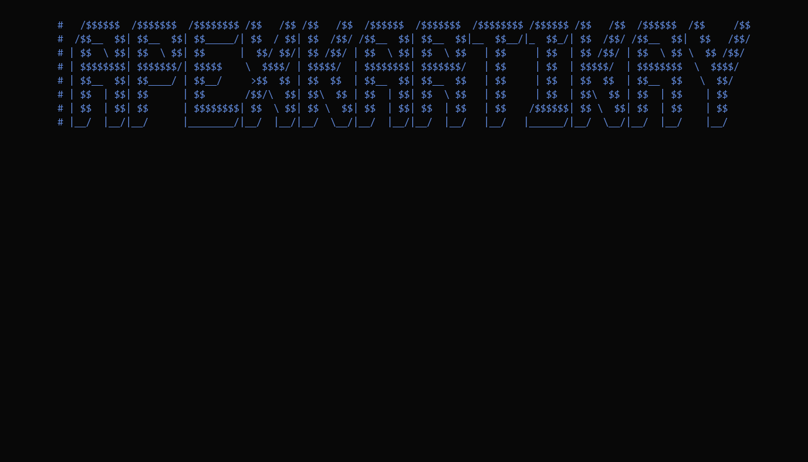
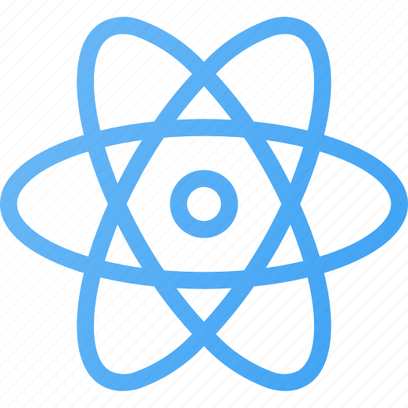
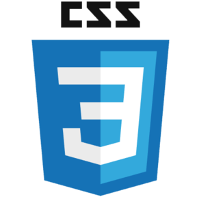
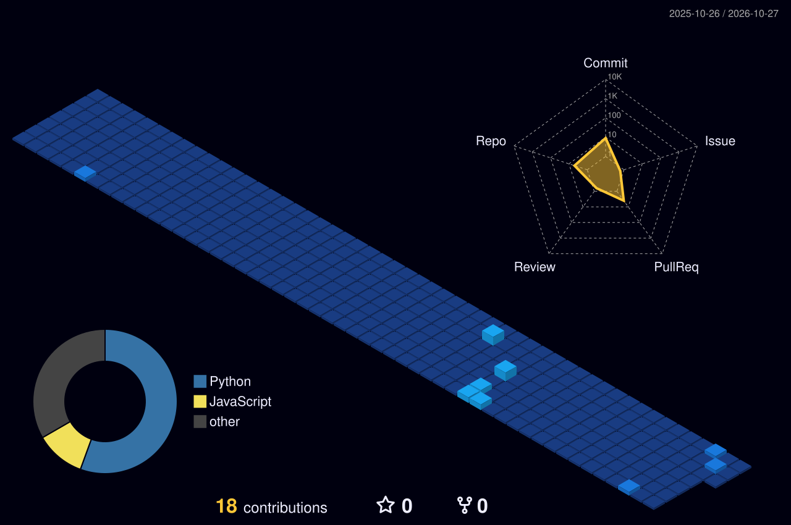

<!-- 
Header Banner / Presentation GIF
-->

<!-- Social Media Icons Section -->
<h1 align="center"> Connect with me </h1>

  
  
  
  

<!-- About Me Section -->
<h2 align="center"> 🤔 About Me 👨‍💻 </h2>

Hey there! 👋  
I am <b>Kartikay Mishra</b>, known across the web as <b>apexkartikay</b> 🕵️‍♂️  
I am from <strong>India 🇮🇳</strong>  
I am a software engineer and computer science undergraduate at <b>SRM University AP</b> who loves engineering scalable software, designing reliable systems, and writing clean, maintainable code 🖥️  
Passionate about software architecture, algorithms, cloud engineering, and continuous learning 🚀 
If you are looking for an energetic developer with strong problem-solving skills and a passion for engineering, <b>⚙️ I AM YOUR GUY ⚙️</b>  
Open to exciting collaborations, open-source initiatives, and engineering roles 📨
   

### 🧐 Quick Highlights:
<table style="border-collapse: collapse; border: none; width: 100%;">
  <tr style="border: none;">
    <td style="border: none; padding: 0; vertical-align: top;">
      <ul style="list-style-type: none; padding-left: 0;">
        <li>🔭 Currently studying CS at <b>SRM University AP</b></li>
        <li>💡 Solved <b>180+ problems</b> on <a href="https://leetcode.com/u/apexkartikay/">LeetCode</a></li>
        <li>🤝 Interested in collaborating on Open Source & System Architecture</li>
        <li>🌱 Exploring Systems Programming, Distributed Systems, & Cloud Engineering</li>
        <li>👨‍💻 All public projects are available on <a href="https://github.com/apexkartikay?tab=repositories">GitHub</a></li>
        <li>💬 Ask me about anything backend, database design, or web dev related</li>
        <li>📫 Feel free to reach out via <a href="https://www.linkedin.com/in/apexkartikay">LinkedIn</a> or <a href="mailto:kartikmk0402@gmail.com">Email</a></li>
      </ul>
    </td>
    <td style="border: none; padding: 0; text-align: right;">
      
    </td>
  </tr>
</table>

  

<!-- Languages and skills section -->

<h1 align="center"> 🛠️ Languages & Technologies: </h1>

  <code></code>
  <code></code>
  <code></code>
  <code></code>
  <code></code>
  <code></code>
  <code></code>
  <code></code>
  <code></code>
  <code></code>
  <code></code>
  <code></code>

 

<h1 align="center"> 🚀 Currently Exploring: </h1>

  <code></code>
  <code></code>
  <code></code>
  <code></code>

 

<h1 align="center"> 💻 Development Environments: </h1>

  <code></code>
  <code></code>
  <code></code>
  <code></code>
  <code></code>

 

<!-- GitHub Stats Section -->

## 📊 GitHub Stats

   
  
  
   

<!-- Top Projects Section -->

## 📘 Top Open Source Projects

  

    
    
  

  
&#8192;

  

    
    
  

&#8192;

&#8192;

  

<!-- 3D Activity Graph Section -->

## 📈 3D Activity Graph

  

 

<!-- Last Refresh Section -->
Last refresh: <b>Thursday, October 22 at 10:26 PM GMT+5:30</b>

<!---
apexkartikay/apexkartikay is a ✨ special ✨ repository because its `README.md` (this file) appears on your GitHub profile.
--->